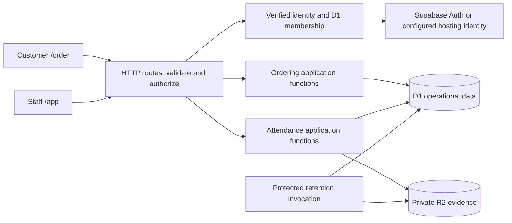

# LoopiCafe: internship portfolio improvement plan

Reviewed: 15 September 2026. Audience: an IT student applying for software engineering internships.

## 1. Recommendation

Position this as **a single-café operations app connecting employee attendance and customer pickup orders**. Finish those two workflows, show how failures are handled, and explain the engineering decisions. You already have enough features for a substantial portfolio project.

Suggested project description:

> LoopiCafe helps a small café record employee shifts and manage pickup orders. Staff check in and out with reviewable attendance evidence; customers order without creating an account; managers handle exceptions and move orders through preparation to collection.

Explain the branding once: **LoopiCafe is the software; La Boong is the demonstration café.** Use that relationship consistently on the landing page, README, screenshots, and CV.

### Review scope and confidence

- Inspected the current local working tree, including uncommitted changes: routes, React components, database schema/migrations, authentication, domain/application modules, tests, CI, and documentation.
- Findings below are based on source inspection unless explicitly identified as executed checks. Concurrency findings describe possible interleavings visible in the implementation; they have not been reproduced against a deployed service.
- No browser/device walkthrough, live deployment, account provisioning, or hosted D1/R2/Supabase verification was performed. Responsive behavior and hosted integrations still need the acceptance checks below.
- This document is a proposed improvement plan. Its proposed features and guarantees are not claims that they are already implemented.
- Verification results from this review are recorded in section 15.

### What a reviewer can already appreciate

| Existing evidence | Why it matters for an internship |
|---|---|
| TypeScript/React UI, Vinext runtime, D1 operational data, R2 evidence storage, Supabase identity integration | More substantial than disconnected CRUD screens; several boundaries to understand and explain. |
| Explicit memberships, server-side role checks, store scoping, final-owner protection | Shows awareness that hiding a button is not authorization. |
| Attendance capture tokens, server timestamps, evidence stamping, exception review and retention code | A useful domain problem with real failure modes. Avoid claiming this proves physical presence. |
| Order menu/options, cart, stored order-item snapshots, status history and customer tracking | A recognizable customer-to-manager workflow. |
| Modules for people, attendance, operations and payroll; a shared HTTP error/client layer | A reasonable modular-monolith foundation. No rewrite is necessary. |
| Migration/schema tests, application behavior tests, a D1 emulator contract test and CI configuration | Evidence of engineering discipline, provided the checks pass and their limits are explained. |
| Architecture and operations notes acknowledge unfinished integrations | Honest tradeoffs make the project easier to defend. |

Recruiter assessment: the project has strong material for a technical conversation. Its current weaknesses are reliability at the main workflow boundaries, reproducibility, and a broad feature story. A reviewer should discover the purpose and demo links in 30 seconds and understand your individual contribution in two minutes. This is an assessment of presentation and engineering evidence, not a prediction about a particular employer.

## 2. Scope: finish a small product

### Portfolio release

- One café; one explicit store timezone: `Asia/Ho_Chi_Minh`.
- Three staff roles: employee, manager, owner. A customer is an unauthenticated visitor with access to their own order receipt.
- Attendance: assigned shifts, check-in/out, own history, exception/correction requests, manager review, basic hours export.
- Ordering: categories and simple search, item options, cart, customer name and phone, pickup checkout, receipt, status tracking, manager queue, menu availability and pause-ordering switch.
- Payment at the counter. An order being completed means collected; do not imply the app verified a payment.
- Manual available/unavailable flags. Describe this as menu availability, not stock accounting.
- Synthetic demonstration data and a repeatable setup.

### Keep secondary features out of the main demonstration

Existing checklists, incidents, handovers and requests can remain as supporting modules. Put payroll calculations behind an “experimental” label or omit them from the portfolio story until their correction/locking behavior is defensible. Retain necessary authorization guards even when navigation is simplified.

The current `team_lead` and `system_admin` roles need not be deleted in a broad refactor. Do not create them in the normal demo, keep support administration private, and explicitly document their permissions while they exist.

### Defer

Delivery logistics, payment gateways, loyalty points, ingredient inventory, face recognition, background location tracking, offline attendance submission, multi-branch SaaS, microservices, Redis, queues, Kubernetes, GraphQL, a native mobile app and a design-system rewrite.

Do not introduce an outbox/reconciliation worker solely for a portfolio milestone. For partial account-provider failures, show an honest failure status and provide a documented operator retry; defer stronger provider synchronization unless real use requires it.

## 3. Highest-value findings and acceptance criteria

**P0:** fix before presenting the corresponding workflow as reliable or exposing it to real data. **P1:** finish for a polished internship demonstration. **P2:** optional after the release is complete.

| Priority / finding | Evidence in this checkout | Smallest useful improvement and acceptance check |
|---|---|---|
| P0 — Browser controls order prices | [Create-order route](../app/api/order/create/route.ts) loads database prices but calculates from `item.price` and submitted topping prices. Unknown item IDs are not rejected by the availability loop. | Accept item/option IDs and quantities. Load valid, available choices from D1 and calculate integer-VND totals on the server. Reject missing items, inactive categories, unsupported options and malformed quantities. Changing a submitted price to 1 must never create a 1-VND order for a 45,000-VND drink. |
| P0 — Order tracking exposes too much | [Tracking route](../app/api/order/track/route.ts) accepts phone alone or a short order code. Code lookup can return other orders for that phone; mismatched phone/code can also include the code's order. | Issue a cryptographically random receipt token at creation, store its hash, and authorize exactly one order with it. Keep the short code for counter staff. Remove unauthenticated phone-history lookup. Return only receipt fields; no internal notes, actor emails or unrelated orders. Test mismatched and missing credentials. |
| P0 — Creation retries can duplicate orders | [Create-order route](../app/api/order/create/route.ts) has no persistent idempotency key. [Cart drawer](../components/order/cart-drawer.tsx) writes localStorage after success, inside the same try block as the request. | Keep one random submission key for an unchanged checkout attempt. Persist a unique key and payload fingerprint with the order. A retry returns the original order; reuse with a different payload returns 409. Make browser storage optional: a storage exception must not turn a committed order into a displayed failure. Test a lost response and blocked storage. |
| P0 — Status updates can race | [Status route](../app/api/owner/orders/%5Bid%5D/status/route.ts) checks the old status before its write batch, then updates by ID alone. | Use a conditional update on ID, store and expected status/version. Commit history only if that update wins. Two managers acting from the same old state produce one transition and one history row; the other receives 409 and fresh state. A batch alone does not protect a preceding read. |
| P0 — Corrections overwrite original evidence time | [Attendance review](../app/api/attendance/review/route.ts) updates `attendance_events.recorded_at`; the README calls events immutable. The stamped image retains the original time. | Preserve original recorded time. Add an append-only correction record with effective time, reason, reviewer and creation time. Display recorded and corrected times distinctly. Validate timestamps, chronological order and closed-report policy. An adjustment must not rewrite original evidence. |
| P0 — Capture consumption needs an atomic guard; preserve the existing session constraint | [Actions route](../app/api/attendance/actions/route.ts) checks token use before the batch, and the token update does not gate event inserts. Migration [0001](../drizzle/0001_eager_peter_parker.sql) already defines a unique open-session index by employee email, although [the declarative schema](../db/schema.ts) omits it. | Atomically claim the unused capture session inside the same guarded write as the event. Preserve and declare the existing open-session constraint; add index-parity coverage. Test that a token cannot create two events and a concurrent unique-key conflict returns/reloads the saved state instead of an opaque 500. Do not add a redundant index or claim migrated databases currently allow two open sessions. |
| P0 — Review history lacks a store check | The `historyFor` branch in [Attendance review](../app/api/attendance/review/route.ts) reads audit rows by event ID without establishing that the event belongs to the actor's store. | Resolve the event through its attendance session and actor store before returning history. Store A must get 404 for Store B's event. This remains a permission boundary even in a single-café product. |
| P0 — Forced password-change state is user editable | [Authentication](../server/auth.ts) uses `user.user_metadata.must_change_password`. | Move the enforced flag to server-owned employee state, or remove that feature from the demo and use provider invitation/password setup. If retained, editing user metadata must not bypass it. Supabase explicitly says user metadata is user editable and unsuitable for security-sensitive decisions. [Supabase documentation](https://supabase.com/docs/guides/auth/users) |
| P1 — Weak order input/error boundaries | Ordering routes use type assertions and string operations on untrusted fields, lack practical limits, and return `details: String(error)` in 500 responses. | Reuse the existing HTTP input/error helpers. Reject wrong types, oversized bodies and excessive quantities. Return a friendly error code and request ID; retain safe server diagnostics. Add simple public-endpoint rate limiting before an unrestricted public demo. |
| P1 — Some order tests repeat implementation | [Ordering tests](../tests/ordering-system.test.mjs) define their own transition map/phone regex and directly manipulate SQLite for several scenarios. | Import the production policy and exercise the application service/HTTP route. A regression in the actual price, permission or transition code must fail a test. Keep useful schema tests. |
| P1 — Migration documentation and metadata drift | SQL `0008_ordering_system.sql` exists, but the Drizzle journal ends at 0007 and the operations guide describes only 0006/0007. Test setup discovers SQL files directly. | Reconcile migration metadata through the supported workflow and document 0008. Verify both a fresh database and an upgrade from 0007 using the actual migration path. Do not rewrite applied migrations or assume a passing file-glob test proves deployment bookkeeping. |
| P1 — Local dates and status freshness | [Owner orders](../app/api/owner/orders/route.ts) filters the UTC date substring. [Tracking UI](../components/order/order-tracking-view.tsx) polls every 3.5 seconds and ignores background errors. Owner polling also suppresses failures. | Convert store-local date boundaries to UTC and query a half-open time range. Show “Last updated” and a reconnect banner; preserve the last good data. No overlapping polls; pause hidden tabs and back off after failure. Test 00:30 local time. |
| P1 — Responsive/accessibility gaps remain | Some item controls are 44px, but cart close is 32px; item/cart panels lack explicit dialog semantics and keyboard focus handling in the inspected source. Cart state is in memory. | Finish dialog keyboard behavior, 44px targets, cart recovery and the viewport checks in section 7. Confirm in a browser; CSS alone is not proof. |
| P1 — Story and maintenance are harder than necessary | README emphasizes attendance and omits the ordering workflow. The owner-order component is about 2,100 lines; tracking is about 1,100. Unrelated course-registration helper scripts are present. | Add the ordering story to README; split order queue/menu editor/dialogs around behavior. Review unrelated files before committing the portfolio repository. Avoid a line-count-only refactor. |

## 4. Realistic user flows

### A. Owner prepares the café

1. Sign in with an explicitly provisioned owner account. A first visitor never becomes owner.
2. Confirm store timezone, address, coordinates and attendance notice/rules. Show what is missing before attendance can be enabled.
3. Add an employee and manager through the existing invitation flow. Surface partial provider failures clearly.
4. Publish a shift, for example 08:00–12:00, and confirm it appears for that employee.
5. Create a small menu, set valid size/topping options, then open online ordering.

**Done when:** a fresh demo can reach this state using documented setup, without editing production data or relying on hidden existing database records.

### B. Employee works a shift

1. Sign in → Today shows the current/next shift and attendance state.
2. Accept the current attendance notice explicitly if needed.
3. Tap Check in → request camera/location → show capture progress and the exception alternative.
4. Submit → show server-recorded time and “Recorded” or “Recorded — review required”.
5. Today changes to “Working” with a Check out action; refresh recovers the same state from the API.
6. Check out → confirm the completed interval or pending exception → view own history.

**Done when:** the persisted interval, employee screen and manager report agree. Loading or a browser clock never determines a successful check-in.

### C. Missing evidence or forgotten checkout

1. Camera permission is denied or GPS times out.
2. Explain the missing evidence; offer Retry and Submit explanation. Keep the existing evidence-exception approach.
3. Server records the action time and flags it for review; do not silently invent a photo or location.
4. For forgotten checkout, the employee requests a specific correction and supplies a reason.
5. Manager reviews the original record, evidence availability and requested change; approves or rejects with a note.
6. The employee sees the decision and effective hours. Original timestamps remain accessible.

**Done when:** rejecting an exception does not silently turn questionable time into approved hours; unresolved events remain visible until resolved. Approval of one event must not clear other unresolved exceptions in the same session.

### D. Customer places a pickup order

1. Open `/order` without an account. Show café name, opening status and “Pickup · Pay at counter”.
2. Browse/search → select drink → choose supported size, sugar, ice and toppings.
3. Review a cart whose rows distinguish different customizations; edit quantity or remove an item.
4. Enter **name and phone only** as required identity fields; note is optional.
5. Submit → server checks menu/options, ordering status and totals.
6. If a price changed or an item sold out, show the changed rows and require reconfirmation. Preserve the rest of the cart.
7. Show receipt code, itemized amount and the private tracking link. Clear the cart only after confirmed creation.
8. Tracking follows preparation; customer presents the short order code at collection.

**Done when:** the order on the manager screen matches the confirmed receipt and appears once despite a retry. No account, OTP or online payment flow is required for this version.

### E. Manager fulfills the order

1. Open `/app/orders` → oldest pending orders are easy to find, with age, code, items and current state.
2. Accept after checking availability → start preparation → mark ready → mark collected/completed.
3. Each card offers the next valid action; show a pending state only on the affected order.
4. Cancel before Ready when needed, with a required reason visible to the customer.
5. If another manager changed it, reload that order and explain the conflict.
6. Pause new ordering during a rush; continue fulfilling already accepted orders.

**Done when:** customer and manager views converge on the same persisted status within the documented polling interval.

### F. Owner closes and reviews the day

1. Review pending orders, missing checkouts and attendance exceptions.
2. Filter by the café's local date; export attendance hours with unresolved/corrected rows identified.
3. Read the history for a correction or cancelled order.
4. Closing ordering stops new submissions but preserves existing order tracking.

**Done when:** “today”, summaries and exported data use the same timezone and business rules.

## 5. Permissions and state rules

### Proposed permission matrix

This is the target product policy, not a claim that every current endpoint already follows it. Implement it server-side and mirror it in navigation.

| Action | Guest customer | Employee | Manager | Owner |
|---|---|---|---|---|
| Browse menu / create pickup order | Yes | Public flow | Public flow | Public flow |
| Track an order | Matching receipt token only | Matching token, unless staff permission applies | Own store | Own store |
| Check in/out | No | Self | Self | Self |
| View attendance | No | Self | Own store | Own store |
| Request own correction | No | Yes | Yes | Yes |
| Review/correct attendance | No | No | Other employees, own store | Other employees, own store |
| Read private attendance photos/coordinates | No | No by default; own summary only | For store review | For store review |
| Publish shifts | No | No | Own store | Own store |
| Update order status / availability / pause orders | No | No in this version | Own store | Own store |
| Change menu names, prices and options | No | No | No in this version | Own store |
| Invite staff / change roles / suspend access | No | No | No in this version | Own store, final-owner protection |
| Change attendance rules / retention settings | No | No | No | Own store |
| Export attendance | No | Own displayed history | Store operational hours | Store operational hours |

Managers currently have broader access in some routes; narrowing it is a deliberate simplification. Do not add a configurable permission editor. A manager's own correction goes to an owner. An owner's correction requires a second authorized reviewer; with only one owner, keep it pending and explain why instead of self-approving.

Every protected request checks active membership, allowed role, store and target resource. Never accept actor email, role or store from the request body as authority. Test forged direct API calls, not just menus. Maintain role checks for legacy support roles and explain the existing team-lead review/photo-access mismatch until resolved.

### Order state machine

```text
pending → accepted → preparing → ready → completed
   └──────────┴──────────┴──→ cancelled (reason required)
```

Use consistent Vietnamese labels: **Chờ xác nhận → Đã nhận → Đang chuẩn bị → Sẵn sàng → Hoàn tất**; cancellation is **Đã hủy**. Completed and cancelled are terminal in this version. Ready orders cannot be cancelled through this simplified workflow. An exceptional dispute after Ready is handled by staff outside this app; do not invent refunds when no payment integration exists.

Keep order progress separate from payment. Do not rename Completed to Paid or infer revenue collected from completed-order totals.

### Attendance state model

Keep work-session state separate from review state:

- Session: not started → open → completed; a missing endpoint remains incomplete.
- Review: pending → approved/rejected, attached to the relevant event/correction.
- Raw event time is immutable. Effective time is derived from an approved correction.
- A rejected or incomplete interval is clearly excluded from approved-hour totals, while its raw records remain visible.
- Store UTC instants; display and filter in the configured café timezone. An overnight shift belongs to its scheduled start date for attendance reporting.

## 6. Edge cases and expected behavior

| Situation | Expected result |
|---|---|
| Double tap or request retry | One order/event. Same key and payload return the same result; different payload with the same key returns 409. |
| Response lost after commit | Show “Checking whether this was saved”; retry using the same key. Do not invite immediate resubmission as a new action. |
| Two simultaneous check-ins from different tabs | Database permits one open session; losing request shows the existing state. |
| Capture token expired/reused/wrong employee | Reject without creating an event. Start a fresh capture only after resolving an uncertain prior submission. |
| Checkout without check-in | Record a review-required exception using the existing approach; do not calculate fabricated hours. |
| No assigned shift / late arrival / early departure | Explain and flag for review according to the saved rules; retain authoritative action time. |
| Overnight shift / midnight / device timezone change | Pair by session/shift, not calendar date alone. Use server UTC and store-local display/filtering. |
| Camera unavailable / poor GPS / device clock wrong | Offer an explanation path. GPS accuracy is evidence, not proof of presence; browser time is not the attendance clock. |
| R2 upload fails | Show that the action requires review if saved as an exception. Never say evidence was stored. Clean up orphan uploads after a database failure. |
| Evidence has expired | Show “Evidence expired”; retain attendance and review history. Verify scheduled deletion separately from access expiry. |
| Correction gives checkout before check-in / invalid date | Reject with a field error. Never clamp invalid intervals to zero and call them correct. |
| Two reviewers decide the same exception | One guarded decision, one audit entry; the loser refreshes. A reason is required for rejection/correction. |
| Attendance correction after report closure | Reject until an explicit authorized reopen, or keep payroll outside the demonstrated release. No silent historic report changes. |
| Item/category/option disappears while in cart | Return a conflict identifying the affected row. Refresh choices and keep unaffected items. |
| Price changes during checkout | Return the current server quote; customer confirms the new amount. Do not silently charge a different price. |
| Browser sends fake price/name/topping/unknown ID | Server rejects invalid selections and snapshots canonical names/prices. |
| Zero, negative, fractional, huge or nonnumeric quantity | Reject, do not silently coerce. Start with limits of 1–20 per row and 50 drinks per order; make the limits visible. |
| Same drink with different options / reordered toppings | Separate genuinely different drinks; canonicalize sorted option IDs to merge equivalent rows. |
| Café pauses ordering while checkout is open | Recheck on submit and reject new orders with the closure message. Existing orders continue. Missing settings default to unavailable until configured. |
| Short order-code collision | Unique database constraint plus bounded regeneration. The receipt secret is separate from the display code. |
| Phone formatting / pasted spaces / +84 | Normalize supported formats once on the server; explain accepted Vietnamese mobile format. A valid format does not verify ownership. |
| Refresh / corrupted cart / blocked localStorage | Restore a versioned non-sensitive draft when possible; safely discard invalid data. Ordering still works without persistent storage. Offer “Remember details” instead of silently persisting phone/name. |
| Receipt link lost | Explain that the customer can contact the counter with the display code. Do not replace it with unrestricted phone-history search. |
| Expired login / suspended staff | 401/403 with a clear recovery route; never show mutation success. Preserve harmless form data, but do not retain camera frames indefinitely. |
| Empty results after filtering | Distinguish “No orders yet” from “No matching orders”; provide Clear filters. |
| More than one page of orders | Explicit pagination/Load more and a result count. Do not silently stop at the current 150-order limit. |
| Data refresh fails while old data exists | Keep last good data, mark it stale, show last-updated time and Retry; never present an empty café as the result of a network error. |

For public order creation/tracking, enforce body and field lengths, no-store responses for personal data, token-safe logging, and basic request throttling. Keep phone numbers and receipt secrets out of analytics and referrer data. Do not expose internal status-history notes through the customer receipt.

## 7. Loading, error, empty and responsive requirements

### Screen-state checklist

| Screen/action | Loading | Empty/unavailable | Error/recovery | Success |
|---|---|---|---|---|
| Sign-in | Disable submit; show signing in | Explain invitation-only access | Invalid credentials vs service failure; retry; useful access-denied page | One redirect into the correct role view |
| Today / attendance history | Stable placeholder matching the final layout | No shift today with next-shift/help text | Retry; retain an already known session state | Server time, work state and review badge |
| Camera/location capture | Separate camera, location and upload progress; expiry visible | Permission unavailable with explanation alternative | Retry capture or submit reason; no stuck overlay | Recorded event ID/time and actual evidence status |
| Menu | Product-card placeholders | No menu yet / no category results / sold out / ordering paused | Retry without losing cart | Menu and current café availability |
| Cart / checkout | One submit in progress; keep order summary visible | Empty cart with Continue browsing | Field errors near inputs; conflicting rows highlighted; unknown-save state | Receipt and tracking link |
| Order queue | First-load placeholders; background refresh unobtrusive | No orders yet or no matching filter | Stale-data banner; inline mutation errors replacing `alert()` | Only the affected row updates; optional short toast |
| Order tracking | Receipt placeholder only on first load | Invalid/expired token message | Last known state, last updated, reconnect/retry | Text status and timestamp, not color alone |
| Review / export | Per-decision progress; export button pending | No exceptions / no report rows | Reason validation, conflict explanation, retry | Decision recorded; file actually downloaded |

Use one error vocabulary and the existing `platform/http` helpers. Suggested responses: 400/422 invalid input, 401 sign-in required, 403 forbidden, 404 inaccessible/missing resource, 409 stale state/quote conflict, 429 retry later, 503 temporarily unavailable. Persistent failures need visible text; a disappearing toast is insufficient.

The mascot/preloader can stay, but do not impose artificial delays or let animation hide an authentication error. Preserve reduced-motion behavior. Retain the existing successful-login navigation approach while testing it; avoid changing authentication and presentation together.

### Responsive acceptance criteria

- Test widths **320, 375/390, 430, 768, 1024 and 1440px**, plus a short landscape viewport. No page-level horizontal overflow. A deliberately scrollable category strip is acceptable.
- Every frequent interactive target is at least **44×44 CSS px**, including close, plus/minus, filters, capture controls and status actions.
- Mobile ordering: readable cards, visible prices, reachable cart button, item bottom sheet, checkout that remains usable above the keyboard. Use safe-area padding and dynamic viewport heights.
- Desktop ordering: a sensible content max-width and side cart/drawer. Do not stretch a phone layout across an entire monitor.
- Mobile staff UI: order/attendance cards with the primary next action visible. Desktop may use tables with clear column labels.
- Fixed headers/footers must not cover inputs, validation messages, totals or the final button. Test on a real Android phone and iPhone Safari when available.
- Text inputs at least 16px; visible focus rings; meaningful button labels; adequate color contrast; status available in text.
- Dialogs have a label, modal semantics, focus moved inside, keyboard containment, Escape close and focus restoration. Closing during a pending write must not cancel knowledge of its result.
- Validate keyboard-only operation and 200% zoom. Use live regions for submission/error/status announcements without announcing every polling tick.
- Camera starts only after an explicit action and all tracks stop when the capture closes. Test permission denial and return from background.
- Use actual rendered screenshots to evaluate layout. Do not claim mobile support because media queries or source assertions exist.

## 8. Architecture: extend the current modular monolith

Keep React/TypeScript, Vinext, D1 and R2 for this release. Explain Vinext as the actual runtime using a Next-compatible application structure. Do not describe this as a stock Next.js production deployment. Keep Supabase as identity for the chosen demo path; D1 remains the operational source of truth. The legacy Supabase SQL is not a second active operational database.



The diagram shows intended responsibility boundaries. Retention invocation needs a separately verified scheduler if the demo claims automatic cleanup. Choose one documented login path for the demonstration and test it; inherited alternate identity paths should not confuse reviewers. Verify that hosting identity headers are trusted only when supplied through the intended authenticated hosting boundary.

### Minimal organization changes

```text
app/api/                       HTTP adapters; role checks and input validation
components/order/              Customer menu, cart, receipt, shared dialogs
components/operational/        Staff views
modules/ordering/
  contracts/                  Shared request/response types and status labels
  domain/                     Price calculation and allowed transitions
  application/                Create order, change status, load receipt
modules/attendance/
  domain/                     Existing rules plus correction validation
  application/                Guarded capture, corrections, evidence lifecycle
modules/people/               Existing membership and access policies
platform/http/                Existing safe client, validation and errors
server/                       Identity, session refresh and audit helpers
db/ + drizzle/                Schema, explicit seeds and migrations
tests/                        Policies, real database/service behavior, browser flows
```

Extract the ordering application functions first because pricing, privacy and transitions need testing. Split the large owner screen into queue, order detail/actions, menu editor and store-status settings as those behaviors change. A small shared polling hook is enough. Do not introduce a state-management library, repository interface per table, or dependency-injection container just to make the diagram look sophisticated.

### Data invariants

- Orders have many item snapshots and status-history rows. Snapshot canonical item/option names and prices so later menu edits do not rewrite receipts.
- Store money as integer VND. Validate finite, bounded integers; database CHECK constraints protect nonnegative amounts, positive quantities and allowed states where practical.
- Add persistent order submission key, payload fingerprint and receipt-token hash; use unique indexes for keys/codes. Define a limited receipt-access period appropriate to the demo and show expiry clearly.
- Attendance sessions have event records; corrections are append-only records referring to those events. Keep current event idempotency/action uniqueness and the migration-defined one-open-session index; declare the latter in the schema and add an atomic token claim. Since employee emails are globally unique in this version, the existing email-based session guard fits the single-café scope.
- Keep foreign keys and store/date/status indexes. Use bounded pagination; measure before adding more indexes.
- D1 batch transactions are suitable for related database writes. A failed statement rolls back the batch, but an UPDATE affecting zero rows is not an error. Gate dependent inserts on a successful change and inspect the results. [Cloudflare D1 batch documentation](https://developers.cloudflare.com/d1/worker-api/d1-database/#batch)
- D1 and R2 do not share a transaction. Preserve the existing upload/cleanup approach and test failures, including cleanup failure after an unsuccessful database commit. Document a manual orphan-cleanup procedure for the demo rather than building a general workflow engine.
- Keep simple polling: approximately five seconds while an order is active, no overlap, no polling on hidden tabs, stop on terminal states, retry with backoff. Document eventual freshness; do not call it a WebSocket realtime system.
- Logs include request ID, operation and safe outcome/duration. Exclude tokens, photos, precise coordinates, phone numbers and raw request bodies. Do not build a monitoring platform for this milestone.

### Example write contracts

`POST /api/order/create`: submission key, customer name/phone, item IDs, option IDs, quantities and optional note. The API returns the canonical receipt plus its private tracking credential. A quote conflict returns affected lines for reconfirmation.

`PATCH /api/owner/orders/:id/status`: expected state/version, desired state and cancellation reason when applicable. The server determines the actor/store and allowed transition.

Attendance submission retains its capture token and submission key. Review/correction uses the event ID, expected review state and reason; effective times are validated and original events remain unchanged.

For token-based tracking, a simple same-origin request carrying the secret in an authorization header is sufficient. A receipt link can hold the secret in its URL fragment, which the page reads without sending it as part of the initial URL request. Treat the link as private; avoid third-party scripts on the receipt view. Replays of a successful checkout must still recover receipt access without creating another order.

## 9. Verification that demonstrates engineering ability

Keep `npm run check` as the main gate. Add tests in the same changes that fix risky behavior, rather than accumulating a large test-only project.

### Focused automated coverage

1. **Ordering:** canonical prices/options; unknown and unavailable items; quantity/body limits; stale quote; duplicate submission and changed payload; receipt isolation; valid/invalid transitions; two simultaneous manager actions; rollback when history creation fails; local-midnight filtering.
2. **Attendance:** shift-rule boundaries; duplicate concurrent check-in; capture expiry/reuse; checkout without a session; evidence failure; correction chronology; unchanged original timestamps; store-scoped history; two reviewers; multiple unresolved exceptions.
3. **Permissions:** guest/employee forbidden from manager writes; cross-store resource IDs; suspended membership; protected private photo retrieval; final active owner; server-owned password setup if retained.
4. **Browser:** employee check-in/out; denied permissions and exception review; guest order through manager completion in two contexts; lost-response recovery; sold-out conflict; expired login; keyboard/dialog and mobile checkout.

Use the existing SQLite helper for service logic and the D1 emulator test for assumptions about batches/guards. Browser tests should interact with visible labels and outcomes. Do not duplicate a policy in a test and then congratulate it for agreeing with itself. [Playwright best practices](https://playwright.dev/docs/best-practices)

Mock camera/location deterministically in browser automation. Test the real permission prompt/camera on a physical device separately. Use isolated synthetic accounts/data and a separate test environment; do not run resets against real staff records.

Record meaningful evidence: commit/version, command, result, browser/device, test date and limitations. Add no arbitrary coverage-percentage goal. A small suite catching price tampering, data disclosure and duplicate writes is more valuable than many shallow assertions.

### Demonstration fixture

One café, one owner, one manager, two employees; 8–12 drinks across 3 categories; a small option set; current and overnight shifts; one completed attendance interval, one missing checkout and one review exception; orders in each relevant status; one unavailable item and one cancellation reason.

Generate dates relative to the demo day. Provide a clearly named local/test-only seed command with environment checks, documented demo access, and a reset procedure limited to the disposable environment. A browser in private mode should be able to place an order; a second browser should show it to the manager. The README should not require an unexplained pre-existing database.

## 10. Prioritized delivery plan

Planning estimate: **58–84 focused hours**, roughly 4–6 weeks at 12–15 hours/week. This is an estimate for one student, including learning and verification, not a promise. Check off acceptance criteria; do not expand scope to fill the calendar.

| Milestone | Effort | Work | Exit condition |
|---|---:|---|---|
| 1. Reproducible baseline | 4–6 h | Record current checks; choose demo auth path; reconcile migrations; document synthetic setup; settle roles/payment/pickup rules. | Fresh local demo can be provisioned and opened from written instructions. |
| 2. Order correctness and privacy | 14–20 h | Server-priced options, receipt token, bounded validation, retry-safe creation, conditional status writes, production-policy tests. | Tampered price, unrelated-order lookup, lost response and concurrent action checks pass. |
| 3. Attendance integrity and permissions | 14–20 h | Atomic capture/open-session guards, append-only corrections, review/history scoping, password-state decision, failure tests. | One interval per simultaneous check-in; original evidence time preserved; forbidden reads/writes rejected. |
| 4. Browser UX and responsive completion | 12–18 h | Persistent safe cart, meaningful stale/error states, keyboard dialogs, mobile flows, real-device attendance check, browser regression suite. | Two core workflows and exception paths pass at target sizes. |
| 5. Portfolio packaging | 8–12 h | README, screenshots, ER/architecture overview, 5-minute video, CV and interview practice, shareable synthetic demo. | Someone unfamiliar with the project can run or inspect it and explain its purpose. |
| 6. Release buffer | 6–8 h | Fix failures discovered in a clean run, review dependency advisories and hosting-specific behavior, final access/fixture checks. | All release criteria below met; unresolved limitations documented. |

### If time is tight

Finish milestones 1–3 and the minimum browser checks/documentation for both core flows. Keep the existing visual style. Drop advanced reports, animation work, dashboard expansion and broad component cleanup. Never replace the privacy/price/duplicate-write fixes with cosmetic work.

### Definition of portfolio-ready

- [ ] Customer and employee workflows each work from start to persisted result.
- [ ] At least one recoverable failure in each workflow is demonstrable.
- [ ] Prices, permissions and state transitions are enforced by the server.
- [ ] Retries and concurrency do not create duplicate orders/open attendance sessions.
- [ ] Original attendance evidence remains distinguishable from corrections.
- [ ] No unrestricted phone-history lookup; no real customer/staff data in the demo.
- [ ] Fresh installation, migrations and explicit demo seed are documented and verified.
- [ ] Main checks and targeted browser tests pass on the release version.
- [ ] Mobile checkout, staff actions and permission-denied attendance are checked in a browser/device.
- [ ] Demo link or recording is accessible to a reviewer, with login instructions and limitations.
- [ ] README/CV describe actual implemented behavior and your actual contribution.

## 11. README structure

Make the opening concise; put detailed operations/security notes in `docs/`.

```text
# LoopiCafe — Café Attendance & Pickup Ordering
1. One-sentence purpose + project status (student portfolio demo)
2. Demo link | 5-minute video | screenshots | demo access instructions
3. Problem, intended users and single-café scope
4. Two main workflows, each explained in 4–6 steps
5. Implemented features / known limitations
6. Screenshots: mobile checkout, employee Today, manager queue, exception review
7. Stack table: technology, its job, reason for using it
8. Architecture diagram + small data relationship diagram
9. Important decisions: authoritative prices/time, retries, permissions, polling
10. Local setup: supported Node version, npm ci, environment variables,
    exact migration/provision/seed steps, npm run dev, expected start page
11. Verification: npm run check + browser-test command once implemented
12. Demo accounts/data and safe local reset
13. Deployment overview, identity prerequisites and retention limitations
14. Security/privacy boundaries and demo limitations
15. My contribution, use of tools/AI, challenges and lessons learned
16. Short prioritized roadmap, asset credits and appropriate licensing
```

The current README already explains attendance evidence well; retain it in a focused section or linked document. Add ordering, screenshots and a concrete setup path. Keep secrets out of examples. Distinguish the Supabase public key from the server-only service credential, and explain D1 as the operational database. Do not present stub commands as working commands: implement and verify seed/browser scripts before listing them in the final README.

Include a short “Decisions and tradeoffs” table:

| Decision | Reason | Limit |
|---|---|---|
| One deployable app | Small project and simpler debugging | Does not prove large-scale service design |
| Server owns prices/timestamps | Browser data can be modified | GPS/photo remain review evidence |
| Database snapshots/history | Preserve what happened at checkout/review | Requires explicit correction rules |
| Polling | Easy to operate and test for a small queue | Updates have a small delay |
| No customer account | Low-friction pickup ordering | Receipt link is needed to view a private order |

Avoid unsupported claims such as “enterprise-ready,” “fraud-proof attendance,” “secure because of JWT,” “real-time inventory,” or “used by 100 cafés.” If you measure anything, record the method and environment. If assets are third-party or recognizable character artwork, credit them and check reuse rights; use original/clearly licensed assets for public portfolio packaging where needed.

## 12. Five-minute demonstration script

Prepare two browser contexts, synthetic records, a current shift and at least one pending exception. Explain that abbreviated live check-in/out timing is for demonstration; use a seeded completed interval to show realistic hours.

| Time | Show | Say / prove |
|---|---|---|
| 0:00–0:25 | Landing/README and the two app entry points | “This is a single-café pilot for employee attendance and pickup orders. Customers do not need accounts.” |
| 0:25–1:15 | Employee Today → check-in → refresh | “The server records time. Camera/location are requested only when needed. Refresh shows the saved session.” |
| 1:15–1:50 | Missing-evidence example → manager exception review | “If a device cannot provide evidence, staff submit a reason. A reviewer decides; original events are preserved.” |
| 1:50–2:45 | Mobile `/order` → custom drink → name/phone → receipt | “The server validates selections and determines prices. Payment is at the counter.” |
| 2:45–3:35 | Manager queue and customer tracking side by side | Move Accepted → Preparing → Ready → Completed. “Both screens read the same stored order; updates arrive by polling.” |
| 3:35–4:15 | One failure: unavailable item or lost-response retry | “The cart is preserved, and retrying the same submission does not create a second order.” |
| 4:15–4:45 | Architecture diagram and one meaningful test | Explain where authorization and the guarded write occur. Show a test that invokes production code. |
| 4:45–5:00 | Known limitations and contribution | “I focused on two complete flows. Delivery, online payments and inventory accounting are outside scope.” |

Keep a 60–90 second screen recording as a fallback for network/device failures. Do not show credentials, tokens, real phone numbers or real employee photos. If a fix is unfinished, name it as next work instead of speaking the future-state lines as current facts.

## 13. CV and application material

Suggested title: **LoopiCafe — Café Attendance & Pickup Ordering | TypeScript, React, Cloudflare D1/R2, Supabase Auth**. Add Vinext in the detailed stack/README so the runtime is clear.

### Conservative bullets supported by the inspected implementation

Use only the work you personally implemented or can accurately describe as your contribution; source presence alone does not establish authorship.

- Developed a TypeScript/React café application with employee attendance capture, manager review, guest ordering and order-status tracking backed by Cloudflare D1.
- Integrated role-aware staff access and private attendance-evidence storage, with server-generated timestamps, audit history and evidence-expiration handling.
- Added database migrations and automated checks for application behavior, schema consistency and D1 transaction assumptions.

### Stronger bullets after the proposed fixes are implemented and verified

- Implemented server-authoritative order pricing and persistent idempotency, preventing tampered totals and duplicate orders during network retries.
- Enforced store-scoped permissions and conditional status updates, with regression tests for unauthorized access and concurrent manager actions.
- Built responsive guest checkout and employee attendance flows with recoverable error states, verified through automated browser tests and real-device checks.

Choose **three bullets**, tuned to the role. For frontend internships, emphasize forms, responsive interaction, accessibility and browser states. For full-stack internships, emphasize SQL invariants, authorization, retries and tests. Do not invent user counts, latency improvements, uptime or percentages. If the work was AI-assisted, explain how you reviewed, changed and tested it; do not claim sole authorship of another person's work.

Suggested 30-second introduction:

> I built LoopiCafe around two café workflows: employee attendance and customer pickup orders. The main engineering challenges were preserving trustworthy attendance records, keeping order totals authoritative, and handling retries or two people acting at once. I kept it as one application with a relational database, and focused the tests on those failure cases. The demo uses synthetic data and does not include online payments or full inventory management.

Use the introduction only after the relevant fixes and tests exist; otherwise describe them as the next improvements.

## 14. Interview questions and preparation

| Likely question | What a strong answer should cover |
|---|---|
| What problem does this solve, and for whom? | One café, employee/manager/customer tasks, why two connected workflows matter; distinguish pilot assumptions from user research. |
| What did you personally build? | Concrete files/decisions, one difficult bug, verification performed, collaborators/AI assistance honestly described. |
| Why this stack and Vinext? | Actual runtime and hosting constraints, familiar React/TypeScript model, relational operations; tradeoffs and compatibility checks. Avoid claiming it is ordinary Next.js deployment. |
| Why one application instead of microservices? | Small team/domain, simpler transactions, setup and debugging; extract a service only for a demonstrated boundary or scaling need. |
| What is authentication versus authorization here? | Identity proves who signed in; D1 membership/role/store/resource checks determine allowed actions on every protected request. |
| Can an employee change their role in the browser? | UI is not trusted; server-owned role data, denied direct API calls, safe identity metadata handling. |
| How do you stop fake checkout prices? | Client sends IDs, server loads canonical prices/options, integer arithmetic, validation and immutable purchase snapshots. |
| What if the user clicks twice or loses the response? | Persisted submission key, unique constraint, same-result retry, changed-payload conflict, distinguish unknown result from failed write. |
| What if two managers update the same order? | Compare expected state/version in the UPDATE; one winner; history gated with the write; 409 refresh for the loser. |
| Why is a transaction not enough to prevent that race? | A read before the transaction may already be stale; zero-row update is not an exception. Show the guard and regression test. |
| Can a short order code or phone prove ownership? | No. Code is a display identifier; private receipt credential authorizes one order. No phone-only history. |
| Can GPS/photo prove the employee was at the café? | They provide reviewable evidence and can be spoofed or inaccurate. Server time and explicit exceptions help; no fraud-proof claim. |
| What happens on denied permissions or slow internet? | Camera/location timeout, explanation route, honest saved/evidence status, retained input and safe retry. |
| How do overnight shifts and timezones work? | UTC storage, store-local presentation/date boundaries, session pairing and start-date attribution. Give a midnight example. |
| How do you correct attendance without rewriting history? | Immutable raw timestamp, append-only correction, reviewer/reason, effective-time calculation and report-lock rules. |
| What if R2 succeeds and D1 fails? | No shared transaction; cleanup/compensation, retryable deletion, operational limit for orphan handling. |
| How did you choose your tests? | Risk-focused tests calling production logic; database integration versus source checks; browser/device verification has a different job. |
| How did you make it accessible on mobile? | 44px targets, keyboard dialogs, focus management, safe areas, zoom, real viewport/device evidence. |
| Why polling rather than WebSockets? | Low-complexity queue, documented delay, backoff and hidden-tab pause; measure before increasing complexity. |
| What would you improve with more time? | First unresolved limitation grounded in tests/use, such as provider reconciliation or report closure; not a list of trendy technologies. |
| What would fail at ten times the traffic? | Current unmeasured limits; polling/read volume and large list queries; bounded pagination, measurements and platform constraints before redesign. |
| What did you learn from a bug? | Explain the storage-after-success or stale-status problem: trigger, root cause, changed behavior, test and remaining limitation. |

Prepare three short technical stories: a permissions boundary, a retry/concurrency bug, and a mobile/error-state improvement. For each, explain the initial behavior, your hypothesis, evidence, fix, test and tradeoff. Be able to walk from a button click through the route to the database and back without reading generated commentary.

## 15. Review verification record

Executed `npm run check` against this local working tree on 15 September 2026; the command exited successfully.

| Check | Result |
|---|---|
| Workers type generation and TypeScript checking | Passed |
| ESLint | Passed |
| Automated test suite | 37 passed; 0 failed; 0 skipped |
| Vinext production build | Passed |

The build emitted plugin-timing notices and reported that some routes could not be classified by static analysis. It still completed successfully. The Node test runner also emitted its SQLite experimental-feature warning.

Passing these checks does not invalidate the source findings: several ordering tests exercise duplicated logic or direct SQL instead of the actual application boundary, and there are no browser runs in this verification. No claim is made about production exploitation, deployed availability, real-device layout, dependency-advisory status, automatic retention scheduling, or hosted integration correctness. The code changes proposed above have not been implemented by this analysis.
