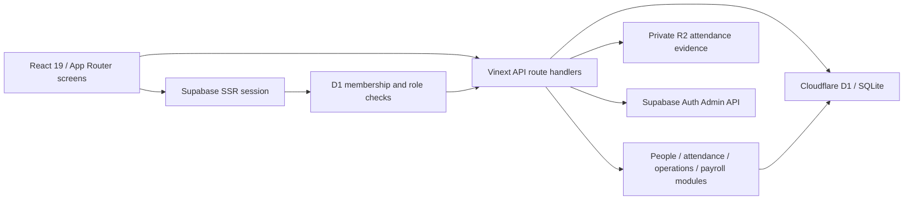

# LoopiCafe — local production-readiness audit

Audit date: 2026-09-17. Baseline: the existing working tree, including its uncommitted changes. This report precedes implementation. Findings below describe that baseline; remediation results are recorded separately. No deployment, remote Git write, cloud database change, or cloud account operation is authorized.

## 1. Current architecture

- A modular monolith using TypeScript, React, Next-compatible routes through Vinext/Vite, Cloudflare Workers, Drizzle schema and SQL migrations. No framework rewrite is needed.
- `app/` owns pages and HTTP routes; `components/` owns interactive screens; `modules/` contains selected business workflows; `platform/http/` contains shared input/client/error helpers; `server/` owns identity and audit adapters; `db/` owns bindings/model/explicit demo provisioning; `drizzle/` owns SQL history.
- Most state is component-local React state and fetch/reload. Customer name/phone and remembered login email use localStorage. Cart state is memory-only. No global state framework or message queue is required for current scope.
- Operational data is D1, not the legacy PostgreSQL schema in `supabase/`. Photos are server-stamped JPEGs in private R2, with coordinates and retention metadata in D1. Supabase provides authentication, invitation and password administration.
- Additional external requests include map tiles and address lookup. Local operation must not require these services: coordinate entry and an offline map fallback are sufficient.
- The app has `system_admin`, `owner`, `manager`, `team_lead`, and `employee` roles. Most APIs perform backend checks and store filtering; several exceptions below defeat that protection.
- `.env.local` currently configures non-loopback Supabase and application URLs. Its values are intentionally omitted. D1/R2 state is project-local. The current configuration therefore is not fully local.
- The machine has Node 22.19/npm 10.9. Docker and Supabase CLI were not found in PATH or the standard Docker installation location during the audit.

### Existing useful safeguards

Parameterized SQL; active membership lookup on protected requests; final-owner conditional update; atomic access-change/audit and request-decision/notification batches; immutable finalized payroll snapshots; camera/location consent; short-lived capture tokens; server-side JPEG decode/stamping; private photo access; retryable retention; generic errors in migrated HTTP handlers.

The SQL migration chain already contains unique indexes for one open attendance session per employee and one event per session/action. They must not be reported as absent merely because the ORM model omits a partial index.

### Status interpretation

“Implemented” means traced in source, not browser/provider certified. No subsystem is certified production-ready by a build alone. Existing business modules have meaningful SQLite tests; source assertions and duplicated test logic provide weaker evidence.

## 2. Feature inventory

| Feature | Roles | UI / backend | Tables or service | Baseline status and issues |
|---|---|---|---|---|
| Login, persistent session, logout | All members | `/auth/*`, session/auth adapters | Supabase + employees | Implemented; forged-header fallback, mutable password flag, incomplete recovery UX |
| Invitation/account activation | Owner/admin; manager limited | account/team views, admin/accounts, auth/activate | Supabase + employees | Implemented; two-service failure reconciliation incomplete |
| Employee create/edit/disable/role | Owner/manager/admin hierarchy | team + accounts APIs | employees, audit_events | Shared role checks and final-owner guard; UI/admin role mismatch |
| Store settings and attendance rules | Owner/admin API | settings/store, api/store | stores, attendance_rules | One configured shop; no general branch creation/transfer workflow |
| Attendance check-in/out | Participating employee/manager | attendance-capture, capture-sessions/actions | capture_sessions, sessions, events, locations, photos, exceptions | Real persistence; token/concurrent retry and correction gaps |
| Attendance review/history | Owner/manager | attendance/review, reports | sessions/events/exceptions, audit_events | Review exists; raw timestamp overwritten; history not fully store-scoped |
| Schedule and assignment | Owner/manager/team lead; employee reads own | schedule, api/shifts | shifts, notifications | Create/read only; oldest 250 rows cap; partial batch and overlap race |
| Leave/swap/correction requests | Staff submit; owner/manager review | requests views/API | requests, notifications | Status workflow exists; no structured date/shift linkage |
| Payroll and exports | Owner/manager | payroll-reports, reports/payroll and exports | periods, entries, sessions, shifts | Snapshots/locks exist; month-boundary double count and departed-worker omission |
| Checklists | Members; management creates | checklists view/API | checklist_items | Completion is shared/global, not dated shift execution |
| Incidents | Staff report; management reviews | issues view/API | incidents | Persistence exists; resolve/close incomplete in UI |
| Handovers | Staff submit; management acknowledges | handovers view/API | handovers | Saved summary not displayed in existing list |
| Dashboard/today | Role-dependent | dashboard/today views/APIs | operational aggregates | Real queries mixed with hardcoded attendance wrapper content |
| Profile/notifications | Current member | profile/notifications | employees, notifications | Basic implemented workflows; validation/error consistency needs review |
| Audit log | Owner/admin | audit view/API | audit_events | Global query and missing store provenance leak other-store events |
| Public menu/cart/order | Guest | `/order`, api/order/menu/create | menu tables, customer_orders/items/history | Client-supplied prices accepted; size surcharge lost; no persisted idempotency |
| Guest order tracking | Guest | tracking view, api/order/track | customer_orders/items/history | Phone or short code exposes customer-wide history and notes |
| Order board/status | Owner/manager/admin | app/orders, api/owner/orders | orders/history | Read-then-unconditional update permits conflicting transitions |
| Menu/store ordering settings | Owner/manager/admin | order management views/APIs | menu/settings | Implemented; input validation and same-store category checks need tightening |
| Retention | Operator bearer secret | api/cron/retention | evidence tables + R2 | Retry-aware implementation; no scheduler configured |
| Demo data | Explicit operator | seed endpoint/script | D1 and Supabase | HTTP seed is gated; legacy cloud script embeds privileged credential |

## 3. Flow audit and production blockers

Every correction must retain the flow UI → request → identity/role/store check → validation → business rule → atomic persistence → response → UI refresh/error state.

| Priority | Finding and source | Effect / smallest reasonable correction |
|---|---|---|
| P0 | `seed_supabase_cloud.js:4` embeds a service-role credential; file is tracked in Git history | Remove credential-bearing executable content locally; never run it. Cloud key revocation and any shared-history remediation remain explicit future operator actions. Removal does not revoke the old credential. |
| P0 | `server/auth.ts:91`, `app/chatgpt-auth.ts:18`, Worker ingress trust raw identity headers | Local harness impersonated a fixture owner without a session. Disable raw header identity for local/default operation; require verified Supabase identity. Hosted proxy guarantees were not assessed. |
| P0 | `app/api/order/track/route.ts` accepts phone or short order code and expands to phone history | Reproduced disclosure of several orders including personal notes. Require an unpredictable receipt credential for exactly one order. |
| P0 | `app/api/order/create/route.ts:120` trusts submitted monetary fields and does not reject unknown products | Actual handler harness accepted canonical 45,000-priced item at 1 and nonexistent item at 0. Resolve every product/option and price on server. |
| P1 | Order status route updates by id after reading old status | Concurrent cancel/accept both returned success in actual handler harness. Conditional expected-state transition, history in same batch, loser returns conflict. |
| P1 | Payroll report uses full session minutes in every intersecting month and filters current active workers | Actual module test counted 120 minutes in both adjacent months; departed worker disappeared. Clip intervals to period and preserve earned-work eligibility. |
| P1 | Attendance correction changes original `recorded_at`, accepts weak timestamp input and cannot resolve missing checkout | Preserve capture time; append correction provenance and use effective session times. Validate chronology, periods and store ownership. |
| P1 | `app/api/audit/route.ts:10` has no store predicate; review-history endpoint also lacks ownership check | Two-store harness returned other-store audit data. Persist audit store provenance and scope every read. |
| P1 | Password-change requirement lives in user-editable metadata | A client can clear its own flag. Enforce server-owned requirement and a verified password-change endpoint. |
| P1 | Shifts read oldest 250; overlap check and insertion are separate; weekly creation partially succeeds silently | Query a requested date window; reject a conflicting batch atomically; add guarded edit/cancel with historical protection. |
| P1 | Leave requests have only free text | Approved leave neither updates shifts nor prevents absence classification. Add structured shift linkage and transactional approval effects. |
| P1 | Current environment uses cloud auth; no repeatable isolated provisioning/preview workflow | Dedicated local-auth workspace, separate D1/R2 persistence and local-only guards must precede integration tests. |
| P1 | SQL `0008` exists but Drizzle journal ends at `0007`; current local DB has no migration ledger | Glob-based tests mask metadata drift. Reconcile metadata and verify full schema before baselining any existing DB. Do not replay ALTERs blindly. |
| P1/P2 | `npm audit --omit=dev` reports 5 affected packages: 1 critical, 3 high, 1 moderate | Upgrade compatible versions and retest. Advisory severity alone does not establish exploitability in Vinext/Workers. |
| P2 | HTTP validation/errors/rate limits are inconsistent; seed/account provider writes can partially succeed | Shared safe errors and bounded inputs, persistent guest limits, durable reconciliation for provider operations. |
| P2 | Checklists lack per-day execution; incidents/handover UI incomplete | Complete ordinary cafe workflows without introducing a new architecture. |
| P2 | Ordering tests reproduce maps/regex/SQL instead of executing routes | Replace false-confidence assertions with real application/route and browser tests. |
| P3 | Legacy mocked view exports, compatibility bridges, large screens and unrelated local helper scripts | Remove only demonstrably unused app code after regression coverage; preserve unrelated user files. |

Authentication, access control, SQL and payroll reproductions used disposable in-memory databases and injected framework/provider boundaries. They are not deployed penetration tests or browser end-to-end results.

### Database / reliability observations

- Fresh SQL chain has foreign keys and useful indexes, but many state/money/time invariants are only TypeScript declarations, not SQLite CHECK constraints. Add narrowly justified guards after checking existing rows.
- Read-only preflight of the existing local D1 file found all 0006/0007 columns and zero foreign-key violations. No migration ledger exists. This does not prove full schema/index/trigger parity or safe replay.
- Email-based historical references and current-rate reads can change the interpretation of old work. Preserve identity, effective time, rates and finalized snapshots deliberately.
- R2 and D1 cannot be one transaction. Upload/commit failure needs compensating cleanup; retention already retains retry metadata on R2 failure.
- Retention is an endpoint, not scheduled operation. Local simulation should exercise retry/drain behavior and failure signals.
- Public order creation has no durable deduplication; UI disabled buttons alone cannot protect retries after a timeout.
- Timestamp storage should be canonical UTC; business days/months use Asia/Ho_Chi_Minh. Test midnight, overnight and month boundaries explicitly.

### Performance / technical debt

Prioritize date-window queries, bounded pagination, avoiding overlapping polling, and reducing duplicate screen requests. Largest media is a 2.63 MiB opt-in video; optimized mascots are small. Do not introduce caches, microservices or a state-management framework before measured need. Existing request-time DDL has already been removed. Keep modules and move only the workflows touched by fixes out of route handlers.

## 4. Agreed product decisions

- One shop first; maintain and test backend store isolation with a second fixture shop.
- Supabase Auth runs locally with Docker; D1 and R2 remain local emulators. No cloud credentials in the verification environment. Local invitation/recovery mail stays in a local mail inbox.
- Payroll is approved hours × hourly rate plus explicit reasoned adjustments. No tax, insurance or invented statutory overtime rules.
- Guests receive a private link per order. Knowing a phone number or display code must not reveal an order or a customer's history.
- GPS distance is informational only: no automatic rejection or exception solely from distance/accuracy. Missing evidence still follows the existing explanation/review workflow.
- Approved leave marks affected shifts as approved leave, avoids absence classification and flags coverage; no automatic replacement assignment.
- Preserve existing role hierarchy and useful workflows. No remote push, deploy, release, infrastructure change, database reset, credential rotation or external account write during this task.

## 5. Ordered roadmap

1. **Critical bugs:** remove exposed credential from executable source; close forged identity and guest disclosure; canonical order pricing; protect state transitions; fix payroll accounting and attendance provenance.
2. **Architecture stability:** keep modular monolith; add narrow application functions with real tests, shared validation/error handling and explicit identity boundary.
3. **Core flows:** reliable invitations/recovery, edit/cancel shifts, approved leave effects, missing checkout correction, payroll adjustments, operational UI completion.
4. **Security:** backend role/store matrix, request-origin controls, bounded bodies and throttling, safe logs, no public evidence, dependency triage.
5. **Database:** additive migrations, journal/model/index consistency, snapshot compatibility, persistent deduplication, safe isolated migration runner; inspect existing data before adopting it.
6. **Testing:** real business/route tests, D1 emulator transaction tests and browser role/flow tests. Existing source tests remain labeled as such.
7. **Local production simulation:** fresh isolated database and local auth users, migrated schema, private evidence, production Worker build via local preview, complete a cafe operating day and payroll close.
8. **Deployment preparation only:** backup/restore rehearsal, configuration inventory, retention/reconciliation runbook, known limitations and manual go/no-go checklist. Deployment remains a later explicit decision.

## 6. Acceptance and verification

Fixtures: Owner, Manager, Staff A, Staff B; optional system admin/team lead for role regression; suspended/invited users and a second store for denial tests. Synthetic names/photos only. Provision identity first and link its id to D1 membership explicitly; no first-user owner promotion.

For each feature: happy path, invalid input, unauthorized/cross-store access, missing data, duplicate submission, network/server failure and boundary cases. Essential scenarios:

- Login/logout/session expiry, invitation acceptance, password recovery/change, suspended access, forged headers and self-edited metadata.
- Role changes/final owner, duplicate invite, provider timeout and retriable reconciliation.
- Check-in/out, missing camera/location, expired/reused token, duplicate/concurrent requests, late shift, missing checkout, review and immutable capture timestamp, R2 failure and retention.
- Date-window schedule after 250 historical shifts, overlaps/concurrent writes, atomic weekly batch, edit/cancel, leave approval/rejection and stale decisions.
- Overnight/month-boundary payroll, employee departure/rate change, reasoned adjustments, concurrent corrections/finalization, immutable exports and locked-period restrictions.
- Forged price/options/product, unavailable menu item, size surcharge, duplicate order retry, bad/absent receipt token, simultaneous status changes, menu deletion preserving order snapshots.
- Checklist next business day, incident resolution/closure, visible handover summary, notification ownership, store-scoped audit.
- Fresh migrations and repeat-run no-op; preflight rejection of unknown/inconsistent database; restore into a disposable target; no cloud calls in test execution.

Run typecheck, lint, tests and production build after integration; run targeted tests after each change. Commands that initialize/migrate/seed must resolve an explicit disposable local target and refuse remote endpoints. Browser/real-device/provider verification is reported separately from source/unit/build results.

Current verification: read-only schema preflight and the described disposable reproduction harnesses completed. The initial full `npm run check` began but its process result was lost during the mode transition; do not call it a completed pass. A final clean run is required.

References: [Supabase local CLI setup](https://supabase.com/docs/guides/local-development/cli/getting-started), [Next.js Windows advisory](https://github.com/vercel/next.js/security/advisories/GHSA-p293-qw3h-jr36). The latter requires runtime-specific applicability review; no remote exploit was attempted.
